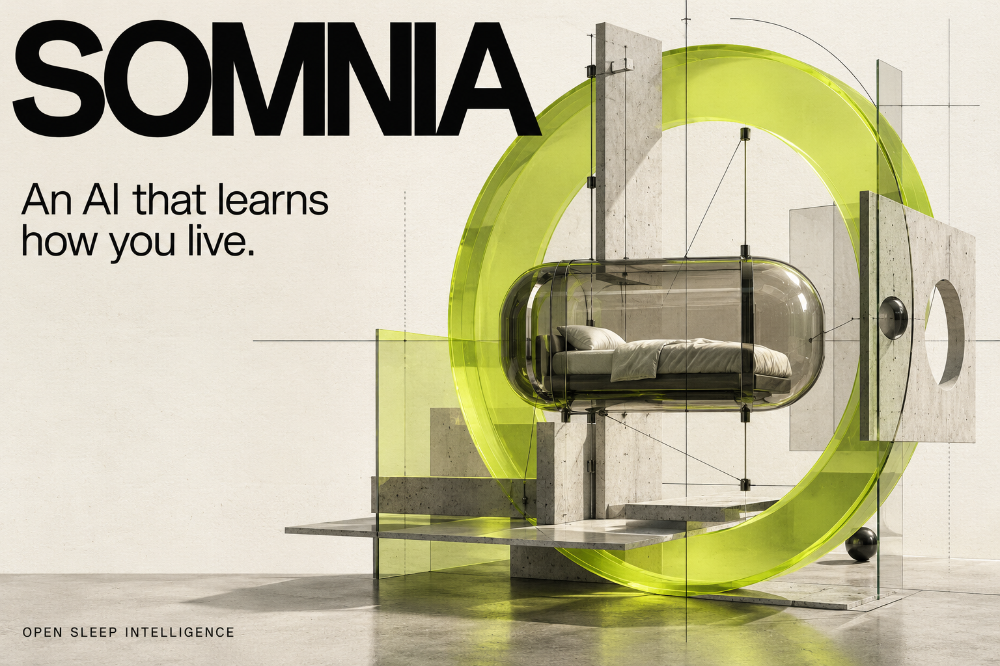
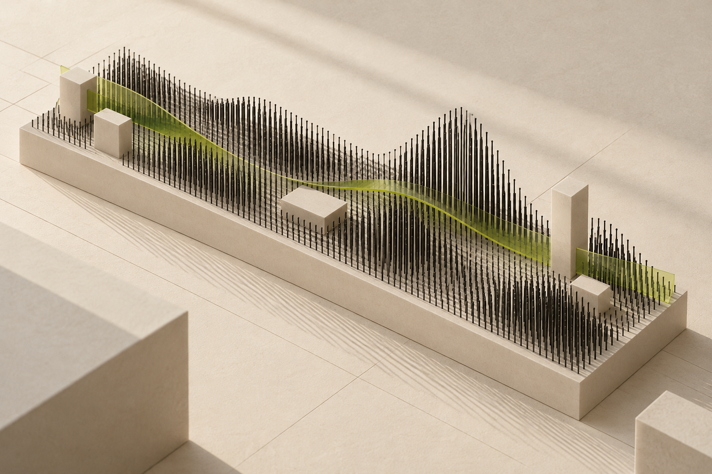
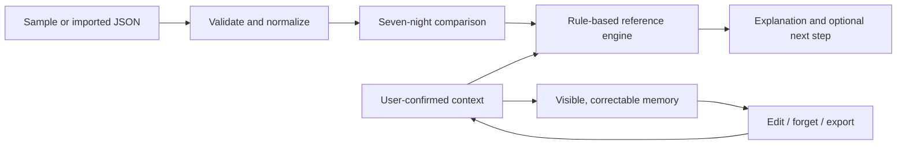

<p align="center"></p>

<p align="center"><strong>OPEN SLEEP INTELLIGENCE</strong><br>Signals. Context. Correctable memory.</p>
<p align="center"><a href="https://ya-way.github.io/somnia/">Explore the live prototype ↗</a> · <a href="docs/ARCHITECTURE.md">Architecture</a> · <a href="docs/PILOT.md">Partner brief</a> · <a href="https://github.com/ya-way/somnia/discussions">Start a conversation</a></p>

# Your nights are data. Your life is the context.

A deadline. A new routine. A mind that will not switch off. Similar sleep charts can have very different stories behind them.

**Somnia explores a personal intelligence layer for smart sleep:** connect device signals with everyday context, maintain a memory the person can correct, and turn each conversation into a useful next step.

For compatible smart-mattress manufacturers, the ambition is an ongoing, branded service after the hardware sale. This repository makes the first piece of that ambition tangible and inspectable.

> **Release status: v0.1.0 · working reference prototype.** The live experience uses synthetic sleep records and deterministic rules. There is no live language model, connected mattress, clinical validation, production deployment or verified commercial traction. The proposed AI and device integrations are described separately in the roadmap. Somnia is not a medical device, diagnosis or treatment.

## Try it in 60 seconds

1. [Open the experience](https://ya-way.github.io/somnia/#lab). Inspect 14 synthetic nights: bedtime moves **50 minutes later** between two seven-night windows while average wake time stays the same.
2. Select **“I’ve been working late”**. The explanation adds the context you supplied without pretending the chart proves a cause.
3. Choose **“I’m having trouble falling asleep”**. The reference engine takes a different conversational path.
4. Edit or forget a memory. Save a suggested plan, export the workspace, or clear it completely.

The 50-minute change and the final 6h 42m night are fixture calculations, **not user outcomes or product performance claims**.

## Run locally

Requires **Node.js 22 or newer**. No account, API key, build tool or dependency installation is needed.

```sh
git clone https://github.com/ya-way/somnia.git
cd somnia
npm start
```

Open **http://127.0.0.1:4173**.

```sh
npm test        # Reference-engine tests
npm run check   # Syntax, page assets and document essentials
npm run build   # Portable static output in dist/
```

To use another local port, set `PORT` before starting. The preview server binds to loopback. The site can be hosted by any static host that serves `.mjs` as JavaScript; no backend is required for this release.

## What you can inspect today

| Capability              | Reference implementation                                                   |
| ----------------------- | -------------------------------------------------------------------------- |
| Nightly signals         | JSON adapter, 1–90 records, explicit dates and 24-hour times               |
| Longitudinal comparison | Recent seven nights against the previous seven, with midnight-aware timing |
| Context                 | Three user-selected conversational paths; no inferred diagnosis            |
| Memory                  | Visible source labels, edit, forget and export controls                    |
| Next steps              | A transparent, rule-based plan that the user can save or remove            |
| Data control            | In-memory session by default; device storage only after opt-in             |
| Portability             | JSON import/export and static hosting, without runtime dependencies        |
| Presentation            | Responsive English homepage and four original structuralist artworks       |

Free-text memories are stored and displayed, **not semantically interpreted** in this release. Editing or forgetting the active structured-context memory clears the corresponding context choice so an old assumption cannot silently continue driving the response.



## The architecture of understanding



The implemented core is intentionally small. It exposes the product contract that a future model must respect: separate observation from interpretation, ask for context, accept correction and preserve user control.

Read the [technical architecture](docs/ARCHITECTURE.md), [data contract](docs/DATA-CONTRACT.md), [privacy boundaries](docs/PRIVACY.md) and [development roadmap](docs/ROADMAP.md).

## A mattress is a product. Understanding is a service.

The commercial thesis is a **B2B software layer for compatible smart sleep hardware**. A manufacturer contributes device access and a real customer setting. Somnia contributes a personal experience that can evolve beyond the initial sale.

Potential commercial forms include paid integration pilots, software licensing and optional ongoing subscriptions. **Pricing, engagement, willingness to pay and distribution economics have not yet been validated.**

The next step is a focused **4–6 week partner pilot**, not a claim of a large market already captured. Test whether contextual explanations are useful, whether memory corrections improve the experience, and whether users return. Agree on success criteria before recruiting participants.

→ [Read the partner and investor brief](docs/PILOT.md)

## Built in the open

```text
somnia/
├── index.html               English editorial homepage and interactive lab
├── styles.css               Responsive structuralist design system
├── app.mjs                  Browser interaction and opt-in persistence
├── src/core.mjs             Validated data model and reference rules
├── examples/nights.json     Fourteen clearly synthetic records
├── tests/core.test.mjs      Data, timing, memory and context tests
├── assets/                  Original artwork and self-hosted fonts
├── scripts/                 Dependency-free server, build and checks
└── docs/                    Architecture, privacy, pilot and roadmap
```

Contributions are welcome, especially around device adapters, accessible interactions, test fixtures and evaluation design. Read [CONTRIBUTING.md](CONTRIBUTING.md). Please never submit personal sleep records or other sensitive data in a public issue.

## Visual language

**The architecture of better nights.** Chalk, ink, acid-lime glass. Suspended planes, tension rods and layered structures. The visual identity treats rest as something human, held within a system that can be examined and changed.

The repository includes four original AI-generated images, their [generation prompts and provenance](docs/ART-DIRECTION.md), and self-hosted Manrope / IBM Plex Mono fonts. All UI text remains selectable HTML; the hero artwork is not a flattened interface.

## License and scope

First-party source code, documentation and included generated artwork are released under the [MIT License](LICENSE), to the extent the contributors hold rights in them. Fonts retain their [SIL Open Font Licenses](assets/OFL.txt). This release makes no claim of exclusive rights in AI-generated imagery.

This independent project is not affiliated with other products or organizations named Somnia. The name is a working project identity, not a statement of trademark registration.

<p align="center"><strong>A more personal kind of intelligence.</strong><br><a href="https://ya-way.github.io/somnia/">Experience Somnia ↗</a></p>
