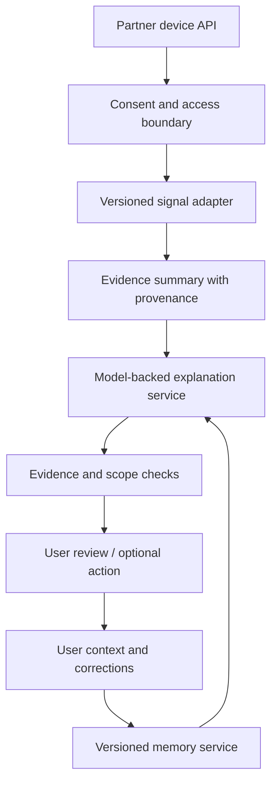

# Somnia architecture

## Current release

Somnia v0.1 is a static browser application and a reusable JavaScript reference engine. It has no service backend or model provider. `src/core.mjs` is shared by the UI and Node tests. It validates inputs, normalizes overnight times, compares two seven-night windows and selects transparent conversational responses.

| Layer       | Implemented behavior                                              | Boundary                                      |
| ----------- | ----------------------------------------------------------------- | --------------------------------------------- |
| Adapter     | JSON array or versioned workspace import                          | No device integrations yet                    |
| Validation  | Dates, uniqueness, time syntax, duration, record and file limits  | Validity is not source verification           |
| Observation | Last recorded duration, recent average, bedtime/wake-time changes | No sleep-stage estimation or diagnostic score |
| Context     | Unknown, late work, difficulty falling asleep, changed schedule   | Selected explicitly by the user               |
| Memory      | Notes with ID, source and update timestamp                        | Free text is not interpreted by the engine    |
| Response    | One context-specific explanation and three general next steps     | Deterministic rules, not model inference      |
| Storage     | In-memory session, optional browser localStorage                  | No encryption, account system or cloud sync   |

## Data flow

1. Load synthetic fixtures or restore an explicitly saved, validated workspace.
2. On import, validate all data before replacing current state. Ignore unsupported record fields.
3. Anchor bedtimes at noon so midnight does not create a discontinuity.
4. Compare the last seven records against the preceding seven. These are recorded nights; gaps are not filled. Fewer than fourteen records yield no comparison.
5. Explain the observed pattern without inferring its cause. Ask the person for context.
6. Record the selected context as an editable memory. Subsequent selections replace the active structured context.
7. Allow correction, deletion, plan removal and JSON export. Correcting or forgetting the active structured context resets its rule selection to unknown.

This timing approach is appropriate for a constrained overnight prototype. Records do not contain time zones or UTC instants. Daylight-saving transitions, shift work, multi-segment sleep and sessions spanning more than sixteen hours require an expanded adapter contract before use.

## Proposed AI service architecture

The next stage would add an authenticated service between a device adapter and a model provider. This is a design direction, not code that ships in v0.1.

Required before that stage:

- Explicit, revocable permission for each data source and model processing purpose.
- Server-side provider credentials, authentication, per-user authorization and deletion semantics.
- Evidence references for every numerical observation; clear distinction between user statements and system hypotheses.
- Memory updates that propose corrections instead of silently treating model guesses as facts.
- Evaluation cases for stale memories, contradictory context, unsupported causal claims and medically inappropriate outputs.
- Monitoring, data retention policy, operational ownership and an independent review of the intended health-related scope.

Do not place model API keys in this static app. A hosted model feature needs a secured backend and explicit data processing design.

## Static deployment

`npm run build` copies only the public application and assets to `dist/`. The same files work at a domain root or a GitHub Pages project path because local links are relative. The local server binds to `127.0.0.1` and only serves the application, its source module, assets and example JSON.

## Verification

The test suite covers midnight arithmetic, missing comparison windows, invalid and duplicate records, malformed workspace state, memory replacement/deletion and context-specific responses. Browser checks additionally cover responsive layout, keyboard paths, context selection, corrections, opt-in persistence, import/export and clearing data.
